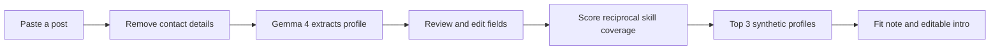

# CoBuild

A small teammate-matching demo for turning a pasted "looking for a teammate" post into a clear skills profile and a shortlist of complementary collaborators.

## Flow



## Screenshot

Screenshot placeholder: run the app and add a screenshot here.

## Setup

Requires Python 3.11 or newer and a Gemini API key with access to the configured model.

```powershell
py -3.11 -m venv .venv
.\.venv\Scripts\Activate.ps1
pip install -r requirements.txt
```

Add `GEMINI_API_KEY=your-key` to the local `.env` file (never commit it), then run:

```powershell
streamlit run app.py
```

The verified model name is in `config.py`. To see Gemma models available to your key, run `python check_models.py`.

## How Gemma 4 Is Used

CoBuild uses the Gemini API and Gemma 4 (`models/gemma-4-26b-a4b-it`) to extract the project, offered skills, needed skills, availability, timezone, and experience level from cleaned pasted text. The app strips email addresses, @handles, and URLs before the text is sent. It retries invalid JSON up to two times, feeding the parse or schema error back to the model.

Matching and the short fit explanation and intro draft are deterministic local code built from the extracted, user-editable fields and synthetic profile data. This keeps recommendations inspectable and avoids inventing candidate details. The draft is editable before the user copies it.

## Evaluation

See [RESULTS.md](RESULTS.md) for top-1 and top-3 agreement on 12 hand-labeled posts. This is a tiny demo set, not a measure of real-world matching quality.

## Privacy and Limitations

- Candidate profiles are synthetic fictional examples; no real people are represented.
- Pasted text is not saved by CoBuild. It exists in the active app session and is sent to the Gemini API after contact-detail redaction for extraction. Review Google's API data terms before using sensitive content.
- The app does not scrape Reddit or any other site. Users paste text themselves.
- Messy or ambiguous posts can be misread. Review and edit the extracted profile before matching.
- Skill synonyms are deliberately small and hand-written; scores are a rough ranking, not a guarantee of compatibility.
- Do not paste secrets or sensitive personal data.

## License

MIT. Copyright (c) 2026 Manahil Rasool. See [LICENSE](LICENSE).
